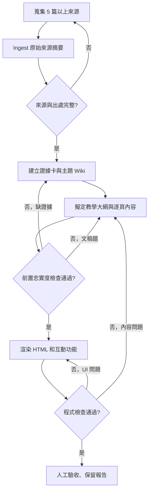

# Workflow / Graph + 局部 Loop 設計

## 目標

將「可信來源 → Wiki → 證據卡 → 簡報 → 驗收」拆成可追溯節點，降低 AI 虛構敘述、改錯整份重做與引用遺失的風險。

## 節點的輸入／輸出／驗證

| 節點 | 輸入 | 輸出檔案 | 驗收 | 退回 |
|---|---|---|---|---|
| A/B | 證交所、金管會網站 | `raw/S*.md`、`sources.md`、`data/sources.json` | 不少於 5 篇、URL 可追溯 | A |
| D | ingested 摘要 | `cards/evidence.json`、`wiki/topics/*.md` | E 編號關聯至少一個 S 編號 | B |
| E/F | Wiki、證據卡 | `data/slides.json` | `validate_draft.py` 強制檢查配息不保證、主動式、E 編號 | D/E |
| G | 已驗收的逐頁內容 | `slides/index.html` 與 CSS、JS | 10 頁、可導航、引用連結 | G |
| H/I | 全部網站 | `reports/*` | Pytest、JS 模擬、人工真實瀏覽 | G 或 E |

## Loop 細則

- 來源問題 → 回 A 或 B，不進入 HTML 排版。
- 知識內容問題 → 修正 E 證據與 Wiki／逐頁文稿，不重製無問題的來源。
- HTML 樣式與互動問題 → 只修正 G 節點，保持已查核文稿不變。
- 每個缺陷最多修正三輪；通過就停止；未通過保留錯誤記錄並交給人工。

## 真實執行中發現的改善

1. 首次靜態檢查：簡報缺少明確的「配息不保證」警語；修正資料稿後重新渲染。
2. 不只在 HTML 產生後才抓錯：新增 `scripts/validate_draft.py`，在「逐頁稿 → 渲染」之間提前檢查。
3. 瀏覽器限制：此執行環境 Chromium 對 file URL 與 localhost 均顯示 `ERR_BLOCKED_BY_ADMINISTRATOR`；此項必須標註為**未完成實際瀏覽器驗收**，不能當作已通過。

## 檢查分級

- **實際執行的可重現測試**：來源、引用、頁數、靜態連結、JS 邏輯。
- **待使用者完成的人工檢查**：Windows／手機瀏覽器是否溢出、連結是否從 GitHub Pages 可正常使用、視覺排版是否符合喜好。
- **條件性發布**：僅在實際取得 GitHub Pages 公開網站且可開啟後，才能宣稱「已公開發布」。
